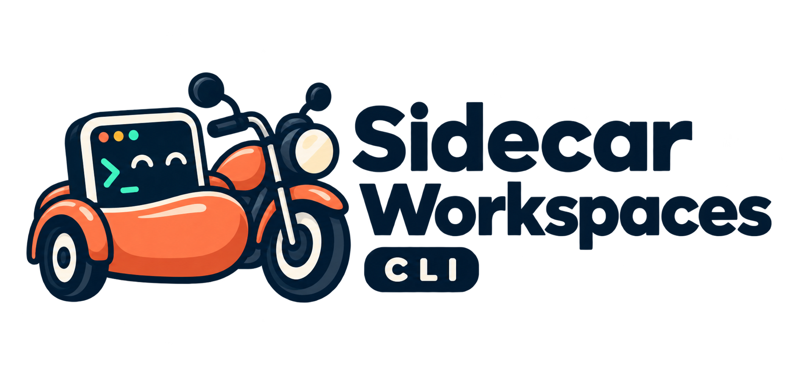

<p align="center">
  
</p>

# Sidecar Workspaces

**Give your next idea its own workspace.**

Sidecar makes a separate copy of your project where you or a coding agent can work without changing the files in your main checkout. Try an idea, run your app, and review the changes before bringing them back.

It copies your local project as it exists now, including files Git ignores, such as dependencies and `.env` files. On macOS with APFS, the copy can use copy-on-write to save time and disk space. On other filesystems, Sidecar makes a regular copy.

A Sidecar workspace is a snapshot: changes made later in your main checkout won't automatically appear in it. It is not a security sandbox. Copied secrets, symbolic links, and commands that connect to shared services such as databases still need care.

## Install

You need [Node.js](https://nodejs.org/) 14.17 or newer, npm, and Git. Then run:

```bash
npm install -g github:liamstewart23/sidecar-workspaces
sidecar --help
```

The first command installs Sidecar from GitHub; you don't need to keep a clone of this repository. It installs from the default branch. To update, run the install command again. To uninstall, run `npm uninstall -g sidecar-workspaces`.

If you want to develop Sidecar itself, see [Installing from a local checkout](#installing-from-a-local-checkout).

## Your first workspace

Start in a **standalone Git checkout** with at least one commit and no uncommitted changes. Linked Git worktrees and submodules aren't supported as source projects. You don't need to add a configuration file.

```bash
cd /path/to/your-project
sidecar up my-idea
```

Wait for the command to finish. It prints a **View** path: that's the folder containing your new workspace. Open that folder in your editor, or start your coding agent there.

Now work in the View folder as you normally would. For example, change some files, run your app, or ask your agent to build a feature. Your main checkout's files stay unchanged until you bring the work back.

When you're ready, run these commands from your main project or the workspace:

```bash
sidecar status my-idea  # See the workspace path and status
sidecar diff my-idea    # Summarize changed and new files
sidecar apply my-idea   # Bring the changes into your main checkout
```

`apply` requires the main checkout to be clean and still at the commit the workspace started from. If the checkout has moved on, bring the changes over manually. Applying includes tracked changes and new files Git doesn't ignore; ignored files stay in the workspace.

`sidecar diff` is a summary, not a full patch. For a closer review, open the workspace's View in your editor and inspect the changed and new files, or use Git there to examine the changes against the base commit shown by `sidecar status`.

When you're finished:

```bash
sidecar down my-idea            # Stop managed processes; keep the files
sidecar remove my-idea --force   # Permanently remove the workspace
```

Inside the View folder, you can omit the name for commands such as `sidecar status`, `sidecar diff`, and `sidecar exec -- npm test`.

## Use Sidecar with a coding agent

Sidecar works with Codex, Claude Code, and other agents that can run local commands and access the workspace directory. There is no agent plugin or skill to install yet.

The most straightforward approach is to run `sidecar up my-idea` yourself, open the printed View folder in your agent, and give it a task. For example:

> Build a settings page in this workspace. Run the relevant tests and tell me what you changed.

You can also ask an agent working in your main checkout to create a workspace:

> Create a Sidecar workspace called `my-idea`. Wait for startup, work from the printed View directory, and build the settings page there. Run the relevant tests and show me the Sidecar diff when you're done. Don't apply the changes yet.

The agent needs access to the View directory, which is stored outside the project by default. Its execution environment and permissions may affect whether it can use that path. Start from a supported standalone checkout; for example, don't run `sidecar up` from a linked Codex Git worktree.

Want project-specific instructions for agents? Add a [project guide](#give-people-and-agents-a-guide) that Sidecar can print for each workspace.

## Common commands

Run these from your main project. From inside a View, the workspace name is optional for these commands.

| Command | What it does |
| --- | --- |
| `sidecar up my-idea` | Create a workspace and run configured startup steps. |
| `sidecar status my-idea` | Show its View path, branch, URL, process health, and log paths. |
| `sidecar exec my-idea -- npm test` | Run a command in the workspace with its configured runtime. |
| `sidecar task my-idea seed-demo -- --fresh` | Run a configured project task with extra arguments. |
| `sidecar guide my-idea` | Print the project guide with workspace details filled in. |
| `sidecar diff my-idea` | Summarize tracked changes and list new files Git doesn't ignore. |
| `sidecar apply my-idea` | Apply changes to the main checkout when it is safe to do so. |
| `sidecar down my-idea` | Stop managed processes and remove its Valet link; keep the workspace. |
| `sidecar remove my-idea --force` | Permanently delete the workspace. |

Run `sidecar --help` for all commands and options. Wait for `up` to finish before running commands that modify or stop that workspace.

## Configure your project

**For most Git projects, you can skip this section.** Sidecar works without a config file. If you want to start a server, define tasks, or customize storage, run this in your project root:

```bash
sidecar init
```

This creates `.sidecar.json`. In a Git project, put it at the Git root and commit it before creating a workspace: Sidecar requires a clean checkout. For a project without Git, `sidecar init` identifies the project, but `diff` and `apply` require Git.

For example, to start a Node development server when the workspace starts:

```json
{
  "version": 1,
  "processes": {
    "dev": {
      "command": "npm run dev",
      "autostart": true
    }
  }
}
```

Every config must include `"version": 1`. See the [configuration reference](#configuration-reference) below and these examples:

- [Node dev server](examples/node-dev-server.json), including NVM setup.
- [PHP + Valet](examples/php-valet.json), including secure local URLs and PHP isolation. The project's `.valetrc` chooses the PHP version.
- [Docker Compose](examples/docker-compose.json), including a long-running process and a test task.

Copy an example into `.sidecar.json` and adjust it for your project. For settings specific to your machine, use `.sidecar.local.json`; it overrides the shared config. Add it to your project's `.gitignore` if you don't want to commit it.

### Tasks and automatic steps

Use `sidecar exec` for a one-off command, a **task** for a repeatable command, and a **hook** to run tasks automatically at a workspace lifecycle step.

```json
{
  "version": 1,
  "tasks": {
    "seed-demo": {
      "command": "./scripts/sidecar/seed-demo \"$SIDECAR_NAME\""
    }
  },
  "hooks": {
    "afterUp": ["seed-demo"]
  }
}
```

This runs `seed-demo` after startup. You can also run it yourself, with extra arguments:

```bash
sidecar task my-idea seed-demo -- --fresh --account=123
```

Hooks are `beforeUp`, `afterUp`, `beforeApply`, `afterApply`, `beforeDown`, and `afterDown`. Each hook runs its listed tasks in order. Put commands in the config or scripts it references so you can review what they do.

### Give people and agents a guide

Add a `SIDECAR.md` file at your project root to explain how to work in a workspace. Sidecar prints the guide; it doesn't execute it.

```md
# Sidecar guide

Work only from `{view}` on branch `{branch}`.
Open `{url}` after startup.
Run `sidecar task {name} seed-demo -- --fresh` when a demo account is needed.
```

Run `sidecar guide my-idea` to print the guide with `{name}`, `{branch}`, `{domain}`, `{url}`, and `{view}` filled in. To use another path within the project, set `agent.guide` in `.sidecar.json`.

### Where workspaces are stored

By default, Sidecar stores workspace files, state, and logs under `~/.sidecar`. To choose a different location for a project:

```json
{
  "version": 1,
  "storage": {
    "root": "../.sidecar-workspaces"
  }
}
```

Relative paths start at the project root. Choose a directory **outside** the project so Sidecar doesn't copy its own workspaces. Each workspace lives under `<storage.root>/projects/<project-id>/sessions/<name>`.

You can set `SIDECAR_HOME` to override storage, for example in CI. Sidecar also keeps a registry index under `~/.sidecar/registry` so it can find workspaces after `storage.root` changes. `SIDECAR_HOME` selects a separate index too; `SIDECAR_REGISTRY_HOME` changes the index location independently, placing it in that directory's `registry` subdirectory. Keep the same index location to find existing workspaces after changing storage.

The index must also be outside the project. If your project contains `~/.sidecar`, set `SIDECAR_REGISTRY_HOME` to an external directory, or use `SIDECAR_HOME` to change both locations.

For workspaces created before the index existed, use their original storage setting to access them by name, or run commands from inside their View. An older workspace belonging to a configured parent project can also be found by name from a nested Git project if no local workspace has that name. New workspaces use the nested Git project.

## Configuration reference

- `version`: Required. Use `1`.
- `processes`: Shell commands Sidecar can manage. On `up`, Sidecar starts a process named `watch`, or the first process with `autostart: true`. `shutdownTimeoutMs` sets how long to wait before force-stopping a process; the default is 5000 milliseconds.
- `tasks`: Named shell commands. Tasks receive `SIDECAR_NAME`, `SIDECAR_BRANCH`, `SIDECAR_DOMAIN`, `SIDECAR_URL`, and `SIDECAR_VIEW`.
- `hooks`: Lists of task names to run at the supported lifecycle steps.
- `runtime`: The shell and bootstrap commands. Bootstrap commands run in order before each managed process, task, and `exec`; use them for tools such as NVM, mise, asdf, or a virtual environment.
- `valet`: An optional local URL through Valet. `domain` can use `{name}` and `{branch}`; Sidecar makes the branch name safe for a domain. `secure` and `isolate` correspond to Valet flags. Sidecar reports a URL only when Valet is enabled and `--no-valet` isn't used. The URL uses `http` unless `secure` is set.
- `storage.root`: Workspace storage directory. Relative paths start at the project root. `SIDECAR_HOME` takes precedence.
- `agent.guide`: Path to the project guide, relative to the project root. Defaults to `SIDECAR.md`.

## Troubleshooting

**The main checkout isn't clean, or `apply` says it has moved on.** Commit or otherwise resolve existing changes before creating a workspace. To apply, the checkout must also still be at the workspace's starting commit. If it has moved on, bring the changes over manually.

**Startup was interrupted.** If startup stopped before Sidecar saved its state, run `sidecar recover my-idea --force` from the project. Recovery preserves partial files in a separate directory and prints the path. It refuses to run while the recorded startup process is active. Older Sidecar versions didn't record that process, so check that no startup is running first. If the workspace already has state, use `status`, `down`, or `remove` instead.

**Recovery was interrupted or reports a lock.** Run recovery again. If it reports a lock from an older version, confirm no recovery is running, then run `sidecar recover my-idea --force --clear-recovery-lock` and retry. Sidecar checks the recorded process when available. If an owner record is missing or incomplete, it asks for `--unverified`; only add it after checking that no startup or recovery for that name is running.

**The workspace state is damaged.** Recovery may ask for `--unverified`. First confirm that no startup or managed processes for that workspace are running. Recovery preserves the workspace files and tells you if the registry needs separate cleanup.

**Sidecar reports an unreadable registry entry or a missing session.** Check the original storage and confirm no startup for that name is running. Then use `sidecar recover my-idea --force --clear-registry --unverified`. Sidecar preserves the entry separately and refuses to clear a readable entry that still points to an existing session directory. You can then check or remove the workspace using its original storage settings.

## Installing from a local checkout

For contributors who want to change Sidecar itself:

```bash
git clone https://github.com/liamstewart23/sidecar-workspaces.git
cd sidecar-workspaces
npm link
```

Alternatively, run `node /path/to/sidecar-workspaces/bin/sidecar.js --help` directly. Run the test suite with `npm test`.
