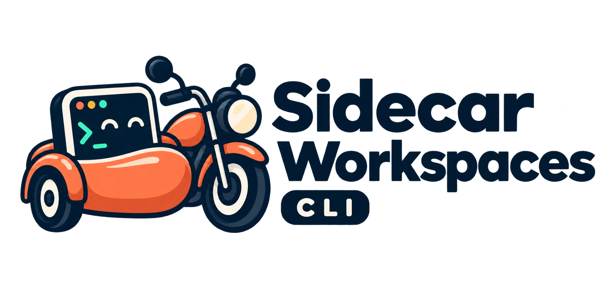

<p align="center">
  
</p>

# Sidecar Workspaces

Sidecar creates isolated development workspaces beside a project’s main checkout. A Sidecar can run project-defined processes, tasks, runtime setup, and optional local URL integrations without depending on a particular agent, language, framework, or web server.

## What Sidecar is today

On macOS with APFS, Sidecar creates a copy-on-write clone of the project. It looks like a complete native checkout to Git, an editor, Codex, Claude, and your development tools, but unchanged file blocks are shared with the main checkout.

This is a **snapshot** at creation time, not a live overlay: later edits in the main checkout do not appear in an existing Sidecar. A future overlay backend can add a literal changed-files-only upper layer.

## Requirements

- Node.js 14.17 or newer to run Sidecar.
- Git for `diff` and `apply`.
- macOS APFS for copy-on-write storage savings. Other filesystems use a regular isolated copy.

## Install

```bash
git clone https://github.com/liamstewart23/sidecar-workspaces.git
cd sidecar-workspaces
npm link
```

Or run the CLI directly:

```bash
node /path/to/sidecar-workspaces/bin/sidecar.js --help
```

## Quick start

Start in a clean Git checkout:

```bash
cd /path/to/project
sidecar init
```

This creates a minimal `.sidecar.json`, a gitignored `.sidecar.local.json` override path, and a `SIDECAR.md` playbook template. Replace the generated configuration with a minimal process setup:

```json
{
  "version": 1,
  "processes": {
    "dev": {
      "command": "npm run dev",
      "autostart": true
    }
  }
}
```

Create a Sidecar and inspect it:

```bash
sidecar up preview-42
sidecar status preview-42
```

`up` prints the Sidecar’s `View` path. Open that directory in your editor, or launch/direct any coding agent from there. The main project checkout remains untouched.

## Optional integrations

Start with only `{ "version": 1 }`, then add integrations when a project needs them:

- [PHP + Valet](examples/php-valet.json): secure `https://<name>.test` URLs and PHP isolation. The project’s own `.valetrc` chooses the PHP version.
- [Node dev server](examples/node-dev-server.json): NVM setup plus `npm run dev`, without a URL integration.
- [Docker Compose](examples/docker-compose.json): a long-running Compose process and a one-off test task.

Copy an example into `.sidecar.json` and tailor it. Put machine-specific overrides in `.sidecar.local.json`; Sidecar merges that file over the checked-in configuration.

## Everyday workflow

| Command | Purpose |
| --- | --- |
| `sidecar up preview-42` | Creates the view, runs `beforeUp`, creates an optional Valet link, starts the default process, then runs `afterUp`. |
| `sidecar status preview-42` | Shows the view, source branch, URL, process health, and log paths. |
| `sidecar exec preview-42 -- npm test` | Runs any command in the Sidecar with the configured runtime bootstrap. |
| `sidecar task preview-42 seed-demo -- --fresh` | Runs a named project task and safely appends task arguments. |
| `sidecar guide preview-42` | Prints the project’s `SIDECAR.md` with Sidecar-specific placeholders resolved. |
| `sidecar diff preview-42` | Shows changed and non-ignored new files before handoff. |
| `sidecar apply preview-42` | Applies safe changes to the main checkout. |
| `sidecar down preview-42` | Runs shutdown hooks, stops managed processes (escalating after their timeout), and removes only its own Valet link. It preserves all work. |
| `sidecar remove preview-42 --force` | Permanently removes the Sidecar. |

Managed-process logs are stored under Sidecar’s state directory. `sidecar status` prints the exact path for every managed process.

## Custom steps and automation

Use the smallest suitable customization mechanism:

| Need | Use |
| --- | --- |
| One-off debugging or setup | `sidecar exec <name> -- <command>` |
| A repeatable project command | `tasks` in `.sidecar.json` |
| A step that must happen automatically | `hooks` in `.sidecar.json` |
| Agent/human instructions and recipes | `SIDECAR.md` |

Tasks are explicit trusted shell commands, so project scripts remain easy to test and review:

```json
{
  "version": 1,
  "tasks": {
    "seed-demo": {
      "command": "./scripts/sidecar/seed-demo \"$SIDECAR_NAME\""
    }
  },
  "hooks": {
    "afterUp": ["seed-demo"]
  }
}
```

Run it manually with arguments when needed:

```bash
sidecar task preview-42 seed-demo -- --fresh --account=123
```

Supported hook names are `beforeUp`, `afterUp`, `beforeApply`, `afterApply`, `beforeDown`, and `afterDown`. Hooks run the named tasks in order.

## `SIDECAR.md`: the project playbook

`SIDECAR.md` is a non-executable guide for agents and humans. It lets each project explain its conventions without turning unstructured Markdown into hidden shell code.

```md
# Sidecar guide

Work only from `{view}` on branch `{branch}`.

Open `{url}` after startup.

Run `sidecar task {name} seed-demo -- --fresh` when a demo account is needed.
```

Run `sidecar guide preview-42` to print this document with `{name}`, `{branch}`, `{domain}`, `{url}`, and `{view}` resolved for that Sidecar. By default Sidecar reads `SIDECAR.md` at the project root; set `agent.guide` in `.sidecar.json` to use another project-relative path.

Keep executable commands in `.sidecar.json` and scripts referenced by it. That makes a task’s behavior explicit and reviewable even when an agent updates the project playbook.

## Configuration reference

Only this is required:

```json
{ "version": 1 }
```

- `valet` is optional. `domain` supports `{name}` and `{branch}` only; the branch placeholder is converted to a DNS-safe slug. `secure` and `isolate` map to Valet flags; without this block Sidecar has no PHP or Valet behavior. A URL is reported only when Valet is enabled and not suppressed with `--no-valet`; it uses `http` unless `secure` is set.
- `runtime` is optional. `shell` selects the shell; `bootstrap` is an ordered list of setup commands run before every managed process, task, and `exec`. Use it for NVM, mise, asdf, virtual environments, or anything else.
- `processes` is optional. Each process has a shell `command`; a process named `watch`, or the first process with `autostart: true`, starts with `up`. `shutdownTimeoutMs` optionally sets the graceful-stop timeout (default: 5000) before Sidecar force-stops a still-running managed process.
- `tasks` is optional. Every task has a shell `command` and receives `SIDECAR_NAME`, `SIDECAR_BRANCH`, `SIDECAR_DOMAIN`, `SIDECAR_URL`, and `SIDECAR_VIEW`.
- `hooks` is optional. Each supported hook contains an ordered list of task names.
- `agent.guide` is optional and points to a project-relative Markdown playbook; it defaults to `SIDECAR.md`.

## Applying work safely

`sidecar apply` refuses to run unless the main checkout remains on the commit used to create the Sidecar and has no uncommitted changes. This prevents silent overwrites from concurrent work.

It applies tracked changes plus non-ignored new files. Ignored build artifacts, dependency directories, and runtime caches stay inside the Sidecar. If the main checkout moved, reconcile the work manually rather than forcing an apply.

## Agent-neutral by design

Sidecar works the same way for a human, Claude, Codex, an editor, or another local tool. The only rule is that all work happens inside the Sidecar’s printed `View` directory.
