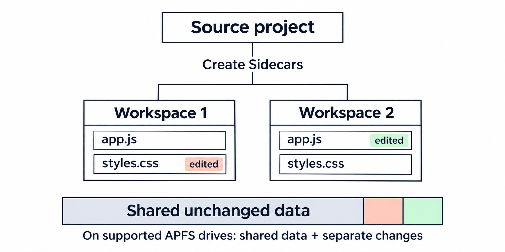

<p align="center">
  
</p>

# Sidecar Workspaces

**Give your next idea its own workspace.**

Sidecar creates a separate copy of your project where you or a coding agent can try an idea. Work there, review what changed, and decide whether to bring it back to your main project.



- **Try ideas separately.** Give each idea or agent its own workspace.
- **Bring your setup along.** The workspace starts with your local project files, including dependencies and files Git ignores.
- **Save disk space when supported.** On a supported macOS APFS volume, unchanged data can share storage using copy-on-write. If cloning isn't available, Sidecar makes a regular copy.

For example, a 10 GB project and three full copies could use around 40 GB. With APFS copy-on-write and only small edits in each workspace, they might instead use around 10 GB plus changed data and filesystem overhead. This is an illustration; actual usage depends on the filesystem and what changes.

A workspace is a snapshot: later changes to your main project don't automatically appear in it. It separates files, but it isn't a security sandbox. Copied secrets and symbolic links need care, and commands may still affect shared services such as databases.

## Get started with a coding agent

Open your project in Codex, Claude Code, or another agent that can run local commands. Start from your **main project folder** (a standalone Git checkout), then try asking:

> I want to try adding dark mode in a Sidecar workspace. First, check whether Sidecar is installed and whether this project is ready. Explain anything I need to do. Then create a workspace called `dark-mode`, wait for it to finish starting, and work from its printed View folder. Build the feature there, run the relevant checks, and explain the changes when you're done. Don't apply or remove the workspace yet.

Replace the idea and workspace name with your own. The **View** is the folder containing the workspace. Your agent needs access to it; by default it lives outside your project. If Sidecar isn't installed yet, use the installation steps below or ask your agent to walk you through them.

Sidecar doesn't require an agent plugin or skill. For more prompts—including review, Valet, asset watchers, and cleanup—see the [coding agents guide](docs/coding-agents.md).

## Install Sidecar

You need [Node.js](https://nodejs.org/) 14.17 or newer, npm, and Git. Run this once in a terminal:

```bash
npm install -g github:liamstewart23/sidecar-workspaces
sidecar --help
```

This installs from the repository's default branch; you don't need to keep a clone. To update, run the install command again. To uninstall, run `npm uninstall -g sidecar-workspaces`.

## Create a workspace yourself

Start in a standalone Git checkout with at least one commit and no uncommitted changes. A standalone checkout is a regular project checkout, not a linked Git worktree or submodule. You don't need a Sidecar config file for a Git project.

```bash
cd /path/to/your-project
sidecar up my-idea
```

Wait for startup to finish and find the `View:` line in the output. Open that folder in your editor or coding agent. Work there as you normally would; your main project's files stay unchanged until you apply the work.

When you're ready, run these from your main project or the View folder:

```bash
sidecar status my-idea  # See the View path and workspace status
sidecar diff my-idea    # Summarize changed and new files
```

`diff` is a summary, not a full patch. Inspect the changed and new files in the View folder before applying them; the [agent guide](docs/coding-agents.md#review-an-idea-and-bring-it-back) has a prompt to help.

When you want to bring the work back:

```bash
sidecar apply my-idea
```

Sidecar requires the main checkout to be clean and still at the commit the workspace started from. It applies tracked changes and new files Git doesn't ignore; ignored files stay in the workspace. If the main checkout has moved on, bring the changes over manually. See [troubleshooting](docs/troubleshooting.md) if you get stuck.

## When you're finished

| What you want | Command | What happens |
| --- | --- | --- |
| Keep the workspace for later | `sidecar down my-idea` | Stops managed processes and removes its Valet link; keeps the workspace files. |
| Delete the workspace | `sidecar remove my-idea --force` | Stops managed processes and permanently deletes the workspace, including any work you haven't kept elsewhere. |

Both commands run configured shutdown hooks. Applying changes doesn't remove the workspace. From inside a View folder, you can omit the name for commands such as `sidecar status`, `sidecar diff`, and `sidecar exec -- npm test`.

## Learn more

- [Coding agents](docs/coding-agents.md): prompts for creating, reviewing, applying, and cleaning up workspaces.
- [Project configuration](docs/configuration.md): development servers, Valet, tasks, hooks, storage, and the configuration reference.
- [Troubleshooting](docs/troubleshooting.md): checkout requirements, interrupted startup, recovery, and registry issues.
- Run `sidecar --help` for all commands and options.

## Develop Sidecar

To work on Sidecar itself:

```bash
git clone https://github.com/liamstewart23/sidecar-workspaces.git
cd sidecar-workspaces
npm link
npm test
```

You can also run the CLI directly with `node /path/to/sidecar-workspaces/bin/sidecar.js --help`.
